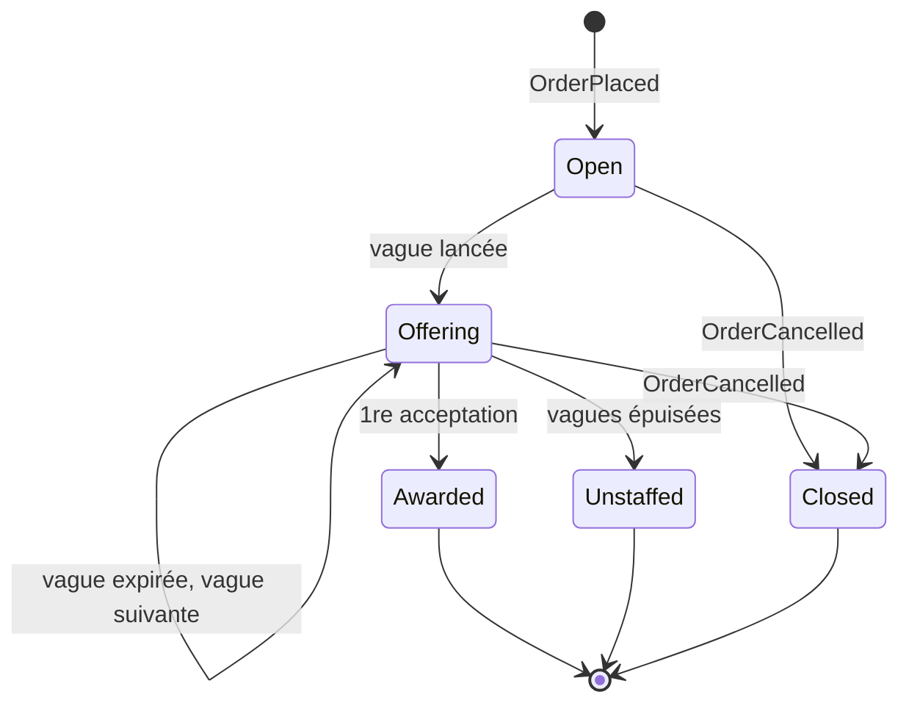
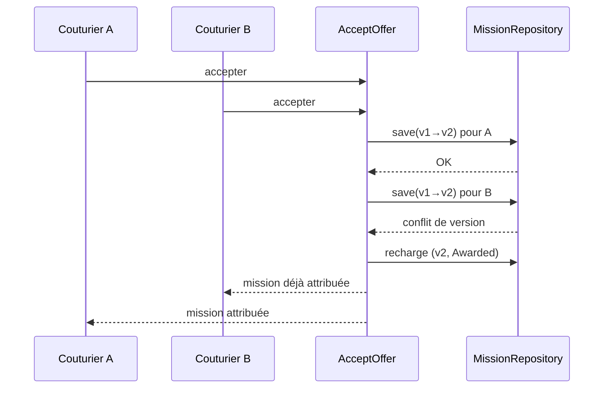

# Bounded context : Dispatch (attribution des missions), core domain

**Sous-domaine** : core · **Interfaces** : l'app couturier (propositions), l'admin (missions non pourvues)

## Responsabilité

Trouver **un** couturier pour chaque commande, vite et bien. Dispatch décide qui est éligible, à qui proposer la mission, dans quel ordre et pendant combien de temps. Il garantit aussi qu'**un seul** couturier remporte la mission.

## Langage ubiquitaire

| Terme | Code | Définition |
|---|---|---|
| Mission | `Mission` | Le besoin d'un couturier pour une commande donnée. Elle existe tant qu'elle n'est pas attribuée, non pourvue ou close |
| Exigences | `MissionRequirements` | Ce qu'il faut pour réaliser la mission : zone, créneaux, compétences requises |
| Candidat | `Candidate` | Un couturier vu sous l'angle de l'attribution : zone d'intervention, compétences, disponibilités |
| Vague | `OfferWave` | Un lot de propositions envoyées **en parallèle** à plusieurs candidats, avec une échéance commune |
| Proposition | `Offer` | La sollicitation d'un candidat pour une mission. Statuts : en attente, acceptée, déclinée, retirée, expirée |
| Attribution | `Award` | Le fait qu'un candidat remporte la mission (premier à accepter) |
| Rendez-vous | `Appointment` | Les 30 minutes que le couturier choisit en acceptant, à l'heure pile ou à la demie, dans un créneau du client. Définitif |
| Mission non pourvue | `Unstaffed` | Toutes les vagues sont épuisées sans acceptation |

Dans ce contexte, « couturier » veut dire **candidat**. Dispatch ne connaît ni son adresse personnelle ni le détail de ses missions passées, seulement ce qui sert à décider.

## Agrégat : `Mission`

La vague et ses propositions sont **à l'intérieur** de l'agrégat `Mission`, ce qui permet de garantir la règle « un seul gagnant » dans une seule transaction.

Invariants :

1. **Une seule acceptation** : dès qu'une proposition est acceptée, la mission est attribuée et toutes les autres propositions en attente sont retirées.
2. On ne peut accepter qu'une proposition **en attente** et **non expirée**.
3. Un candidat n'est jamais sollicité deux fois pour la même mission.
4. Une seule vague active à la fois.
5. Au-delà de `maxWaves`, la mission passe à `Unstaffed`.
6. Accepter, c'est aussi choisir le rendez-vous : **30 minutes**, sur une grille fixe (**9h00, 9h30**…, jamais 9h10), dans le futur, entièrement dans un créneau du client. S'il ne respecte pas ces règles, l'acceptation est refusée et la proposition reste en attente.

Cycle de vie :

### Concurrence : le premier qui accepte gagne

**Quand deux couturiers acceptent en même temps, le premier obtient la mission.** Le second reçoit « mission déjà attribuée », et sa proposition passe à « retirée ».

Le premier est celui dont l'acceptation est **enregistrée en premier par le serveur**. L'heure affichée sur le téléphone ne compte pas, car elle n'est pas fiable.

Chaque couche a son rôle :

- **Domaine** : `Mission.accept(offerId)` refuse toute acceptation si la mission est déjà `Awarded`. C'est la règle, testée sans base de données.
- **Infrastructure** : les deux commandes `AcceptOffer` chargent la même version de `Mission`. La première sauvegarde réussit, la seconde échoue sur un conflit de version (**optimistic locking**).
- **Application** : en cas de conflit, le use case recharge la mission et réessaie. Le domaine répond alors « déjà attribuée », de façon déterministe.

## Stratégie de sélection (domain service)

`CandidateSelectionPolicy` produit la liste ordonnée des candidats d'une vague, en trois temps :

1. **Filtrer** : le rayon d'intervention du couturier couvre le quartier de la mission, il maîtrise **tous** les types de vêtements et **toutes** les matières demandés, il est disponible sur au moins un créneau complet du client, et il n'a pas encore été sollicité.
2. **Classer**, par ordre de priorité :
   1. le plus de créneaux du client couverts ;
   2. le plus proche ;
   3. le moins de missions récentes (**équité** de répartition) ;
   4. l'identifiant, pour qu'une vague soit **reproductible**.
3. **Dimensionner la vague** : les N premiers, N croissant d'une vague à l'autre (3, puis 5, puis tous les éligibles). Le nombre de tailles configurées donne le nombre maximum de vagues d'une mission.

Si plus **aucun candidat n'est éligible**, la mission passe à « non pourvue » sans attendre les vagues restantes.

Comme c'est le cœur du métier, la sélection est une **policy interchangeable**, testée unitairement et séparément de l'agrégat. Le use case `LaunchNextWave` l'appelle à l'ouverture de la mission, à l'expiration d'une vague et quand toute une vague a décliné.

## Événements publiés

| Événement d'intégration | Contenu |
|---|---|
| `MissionAwarded` | missionId, orderId, couturierId, rendez-vous |
| `MissionUnstaffed` | missionId, orderId, nombre de vagues |

## Événements consommés

| Événement | Origine | Réaction |
|---|---|---|
| `OrderPlaced` | Ordering | Ouvre une `Mission` et ne conserve que les exigences : zone, créneaux, et compétences **déduites des types de vêtements et des matières** (une matière habillée demande un couturier qui maîtrise ce tissu). Les coordonnées du client ne sont **pas** conservées |
| `OrderCancelled` | Ordering | Clôt la mission et retire les propositions |

L'**ACL** (`OrderingAcl`) valide chaque événement reçu avec le schéma de `contracts/`, puis le traduit. Le code postal devient un point géographique via le port `AreaLocator` (une table de centroïdes pour la démo, une API de géocodage plus tard). Une commande hors zone connue est **refusée**. L'identifiant de mission est dérivé de celui de la commande, si bien qu'un `OrderPlaced` livré deux fois n'ouvre **qu'une seule** mission.

## Relais de l'outbox

`DispatchEventRelay` lit l'outbox et traite chaque événement de domaine. Un événement n'est marqué « traité » qu'après succès, donc un échec est rejoué.

| Événement de domaine | Réaction |
|---|---|
| `MissionOpened`, `OfferDeclined`, `OfferWaveExpired` | `LaunchNextWave` (sans effet si des propositions sont encore en attente) |
| `OfferWaveLaunched` | Programme l'expiration de la vague (`WaveTimer`) |
| `MissionAwarded`, `MissionUnstaffed` | Publie l'événement d'intégration v1 correspondant |
| `MissionClosed` | Rien pour l'instant |

Le timer d'une vague ancienne peut se déclencher après le lancement d'une vague plus récente, quand toute la première vague a décliné. `ExpireWave` compare alors le numéro de vague et **ignore** l'appel.

## Hors périmètre de la démo

Relances (le système réel relance au bout de 2h), favoris, blacklist, niveau junior/senior, objectifs par couturier. Toutes ces règles s'ajouteraient dans `CandidateSelectionPolicy`.
