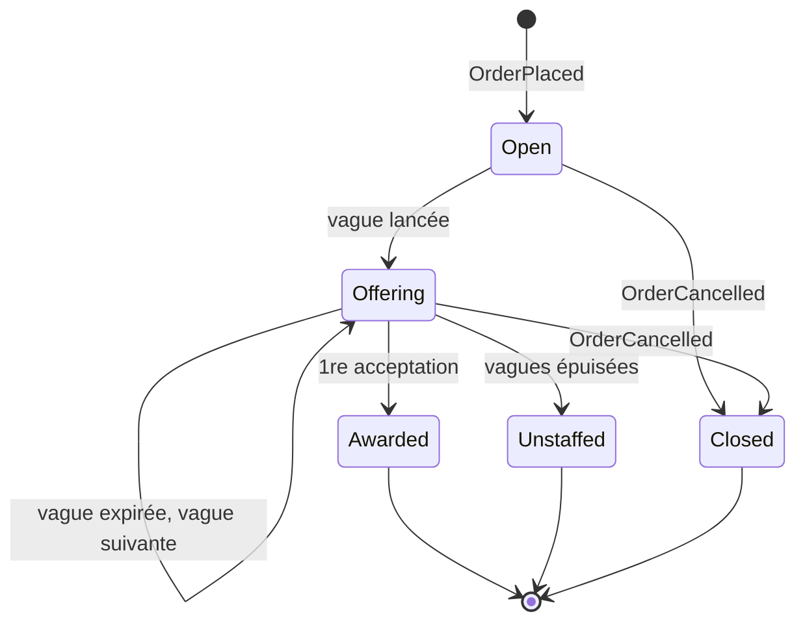
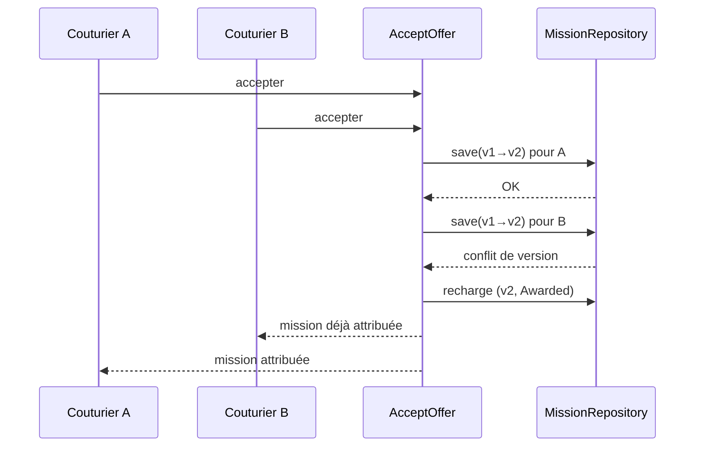

# Bounded context : Dispatch (attribution des missions), core domain

Sous-domaine core. Interfaces : l'app couturier (propositions) et l'admin (missions non pourvues).

## Responsabilité

Trouver un couturier pour chaque commande, vite et bien. Dispatch décide qui est éligible, à qui proposer la mission, dans quel ordre et pendant combien de temps. Il garantit aussi qu'un seul couturier remporte la mission.

## Langage ubiquitaire

| Terme | Code | Définition |
|---|---|---|
| Mission | `Mission` | Le besoin d'un couturier pour une commande donnée. Elle existe tant qu'elle n'est pas attribuée, non pourvue ou close |
| Exigences | `MissionRequirements` | Ce qu'il faut pour réaliser la mission : zone, créneaux, compétences requises |
| Candidat | `Candidate` | Un couturier vu sous l'angle de l'attribution : zone d'intervention, compétences, disponibilités |
| Vague | `OfferWave` | Un lot de propositions envoyées en parallèle à plusieurs candidats, avec une échéance commune |
| Proposition | `Offer` | La sollicitation d'un candidat pour une mission. Statuts : en attente, acceptée, déclinée, retirée, expirée |
| Attribution | `Award` | Le fait qu'un candidat remporte la mission (premier à accepter) |
| Mission non pourvue | `Unstaffed` | Toutes les vagues sont épuisées sans acceptation |

Dans ce contexte, « couturier » veut dire candidat. Dispatch ne connaît ni son adresse personnelle ni le détail de ses missions passées, seulement ce qui sert à décider.

## Agrégat : `Mission`

La vague et ses propositions sont à l'intérieur de l'agrégat `Mission`, ce qui permet de garantir la règle « un seul gagnant » dans une seule transaction.

Invariants :

1. Une seule acceptation : dès qu'une proposition est acceptée, la mission est attribuée et toutes les autres propositions en attente sont retirées.
2. On ne peut accepter qu'une proposition en attente et non expirée.
3. Un candidat n'est jamais sollicité deux fois pour la même mission.
4. Une seule vague active à la fois.
5. Au-delà de `maxWaves`, la mission passe à `Unstaffed`.

Cycle de vie :

### Concurrence : le premier qui accepte gagne

Quand deux couturiers acceptent en même temps, le premier obtient la mission. Le second reçoit « mission déjà attribuée », et sa proposition passe à « retirée ».

Le premier est celui dont l'acceptation est enregistrée en premier par le serveur. L'heure affichée sur le téléphone ne compte pas, car elle n'est pas fiable.

Chaque couche a son rôle :

- Domaine : `Mission.accept(offerId)` refuse toute acceptation si la mission est déjà `Awarded`. C'est la règle, testée sans base de données.
- Infrastructure : les deux commandes `AcceptOffer` chargent la même version de `Mission`. La première sauvegarde réussit, la seconde échoue sur un conflit de version (optimistic locking).
- Application : en cas de conflit, le use case recharge la mission et réessaie. Le domaine répond alors « déjà attribuée », de façon déterministe.

## Stratégie de sélection (domain service)

`CandidateSelectionPolicy` produit la liste ordonnée des candidats d'une vague, en trois temps :

1. Filtrer : dans la zone, avec les compétences requises, disponible sur au moins un créneau, pas encore sollicité.
2. Noter : distance, adéquation des créneaux, équité de répartition.
3. Dimensionner la vague : les N meilleurs, N croissant d'une vague à l'autre (par exemple 3, puis 5, puis tous les éligibles).

Comme c'est le cœur du métier, la sélection est une policy interchangeable, testée unitairement et séparément de l'agrégat.

## Événements publiés

| Événement d'intégration | Contenu |
|---|---|
| `MissionAwarded` | missionId, orderId, couturierId |
| `MissionUnstaffed` | missionId, orderId, nombre de vagues |

## Événements consommés

| Événement | Origine | Réaction |
|---|---|---|
| `OrderPlaced` | Ordering | Ouvre une `Mission` et ne conserve que les exigences : zone, créneaux, et compétences déduites des types de vêtements et des matières (une matière habillée demande un couturier qui maîtrise ce tissu). Les coordonnées du client ne sont pas conservées |
| `OrderCancelled` | Ordering | Clôt la mission et retire les propositions |

## Hors périmètre de la démo

Relances (le système réel relance au bout de 2h), favoris, blacklist, niveau junior/senior, objectifs par couturier. Toutes ces règles s'ajouteraient dans `CandidateSelectionPolicy`.
