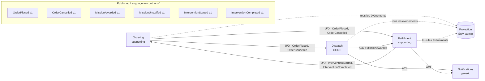

# Context map

## Relations

| Upstream → Downstream | Pattern | Détail |
|---|---|---|
| Ordering → Dispatch | Customer/Supplier + Published Language | Dispatch traduit `OrderPlaced` en `MissionRequirements` et ignore le reste |
| Ordering → Fulfillment | Customer/Supplier + Published Language | Fulfillment garde le contact client et la fiche de travail |
| Dispatch → Fulfillment | Customer/Supplier + Published Language | `MissionAwarded` déclenche la création de l'intervention |
| Fulfillment → Ordering | Published Language | Ordering clôt la commande |
| Contextes → Notifications | Anti-Corruption Layer | Port `Notifier` côté domaine, adapter côté infra |
| Contextes → Suivi admin | Open Host (événements) | Read model dénormalisé, sans logique métier |

## Règles de dépendance

- Un contexte n'importe **jamais** le code d'un autre contexte. Le seul code partagé est `contracts/`, qui contient les schémas versionnés des événements d'intégration.
- Il n'y a **pas de shared kernel** : `Money` ou `TimeSlot` sont dupliqués si besoin, parce que la duplication coûte moins cher que le couplage.
- Les événements de domaine (internes) et les événements d'intégration (publics) sont distincts. Chaque contexte traduit les premiers en seconds.
- La **CI vérifie ces règles** avec dependency-cruiser ou un outil équivalent.

## Le suivi admin est une projection

L'admin ne décide rien. Il affiche, pour chaque commande, une ligne qui agrège les faits des trois contextes :

| Commande | Passée | Mission | Intervenant | Intervention |
|---|---|---|---|---|
| #A12 | 30/10 10:02 | Attribuée (vague 2) | Marie L. | RDV confirmé 02/11 |
| #A13 | 30/10 11:40 | ⚠️ Non pourvue | — | — |

Quand l'admin agit, par exemple pour annuler une commande, il **envoie une commande au contexte propriétaire** (ici Ordering). Il ne modifie jamais la projection directement.
